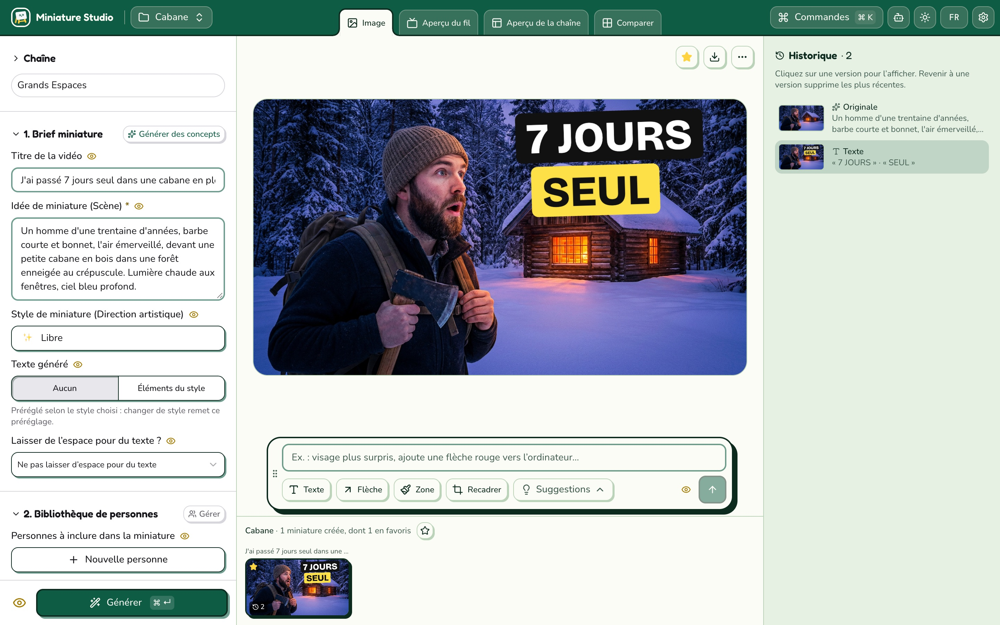

# Miniature Studio



Miniature Studio is a studio on your computer to **create, edit and test YouTube thumbnails** with Google's Nano Banana models. Bring your own API key (Google Gemini, OpenRouter, Mammouth, Replicate) or use Vertex AI through `gcloud`. Your images stay on your computer.

- **Create** thumbnails from a video title and an idea, with styles, people, reference images and brand colours.
- **Edit** them with a sentence, a painted area, text, arrows or a new framing.
- **Test** them among real YouTube videos, on a channel page, and export them for YouTube's Test & Compare.

## Download

**[Miniature Studio 1.0.0 for macOS](https://github.com/guillaume-murat/MiniatureStudio/releases/download/v1.0.0/Miniature-Studio-1.0.0.dmg)** (macOS 14 or later, Apple silicon or Intel)

1. Open the DMG and drag **Miniature Studio** onto **Applications**.
2. Install [Node.js](https://nodejs.org) 22 or later: the app needs it.
3. The app isn't notarized by Apple: open it once, then click **Open Anyway** in **System Settings → Privacy & Security**.
4. Add your API key in the app's settings.

## Run from source

```bash
git clone https://github.com/guillaume-murat/MiniatureStudio.git
cd MiniatureStudio
npm install
npm run local    # http://127.0.0.1:17830/app/
```

`npm run app:mac:install` builds the macOS app into `/Applications`.

## Credits

Miniature Studio is a fork of [NanoThumbnail](https://github.com/yoanbernabeu/NanoThumbnail) by **Yoan Bernabeu** ([YoanDev.co](https://yoandev.co)). MIT license, see [LICENSE](LICENSE).
