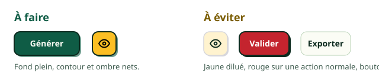
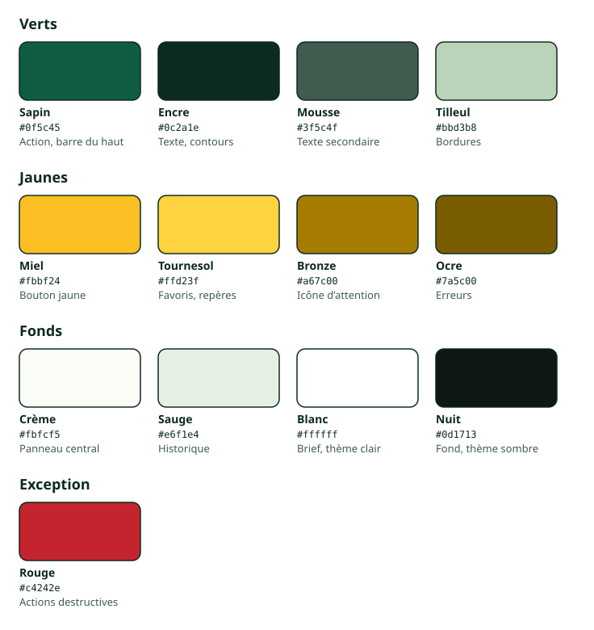
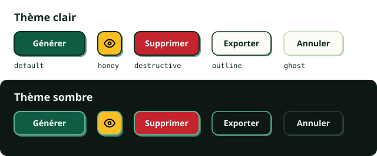
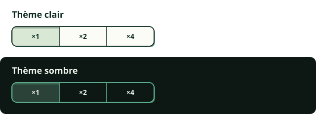
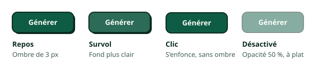
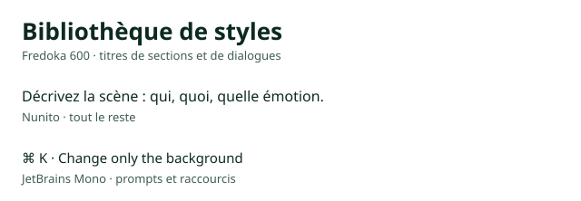

# Design system

Style rétro et joueur, d'après [« Create photo post » retro](https://madegooddesigns.com/inspiration/ui/create-post-web-retro-679d6c96880e) et [playful](https://madegooddesigns.com/inspiration/ui/create-post-web-playful-9597dc774b65) de Made Good Designs. Les valeurs de référence sont dans `src/styles/tokens.css`.

## Les règles

1. **Que des verts et des jaunes.** Seule exception : le rouge des actions destructives, dans les boutons comme dans les menus.
2. **Tous les boutons sont en relief :** contour, ombre dure, enfoncement au clic. Ne sont pas des boutons : onglets, tuiles, lignes de liste, zones de dépôt et chevrons.
3. **Toute ombre est dure, sans flou.** Les images n'ont pas d'ombre. Seule exception : une ombre douce pour garder un repère lisible sur une image.
4. **Le vert sapin porte l'action principale.** Une seule par zone.
5. **En thème clair, le panneau de brief reste blanc,** pour juger les couleurs de marque sur un fond neutre.
6. **On dessine pour l'ordinateur et la grande tablette,** à partir de 1024 px de large, pas pour le téléphone. Trois panneaux, jamais empilés. Sur tablette, rien ne doit dépendre du survol ou d'un raccourci clavier.

## Couleurs

Toujours utiliser un token, jamais une valeur en dur. Le nuancier montre le thème clair ; le thème sombre a ses propres valeurs pour le texte, les contours et les fonds.

Un repère posé sur une image (sélection, poignée, zone peinte, zones de sécurité) est toujours jaune avec un contour encre fixe, pour rester visible sur n'importe quelle image.

Un lien texte sur la barre du haut (le crédit) reste dans ses couleurs : le texte clair de la barre, un peu atténué (85 %, puis 68 % pour une ligne secondaire plus petite), souligné au survol. Le nom de l'auteur, lui, est toujours souligné, pour montrer qu'on peut cliquer. Pas de couleur nouvelle.

Échappent à la règle : les couleurs choisies par l'utilisateur (marque, textes, flèches), les images et illustrations, les aperçus qui imitent YouTube et les couleurs envoyées au modèle.

## Boutons

| Variante | Quand l'utiliser | Exemple |
|---|---|---|
| `default` | L'action principale | Générer |
| `honey` | Une action à mettre en avant à côté de la principale | L'œil près de Générer |
| `destructive` | Une action dangereuse, en rouge, toujours avec un libellé clair et une confirmation | Supprimer |
| `outline` | Une action secondaire | Exporter |
| `ghost` | Les actions fréquentes et les barres denses | Annuler |

Le relief des boutons est une ombre dure en vert sapin à 60 % (`--edge-soft`), sous un contour encre. Les champs de saisie restent à plat : contour de 2 px dans ce même sapin à 60 %, sans ombre. En relief, ils ressembleraient à des boutons. Les listes déroulantes et les pastilles de personnes ont le relief d'un bouton `outline` ; une pastille choisie paraît enfoncée.

Des boutons en relief gardent au moins 8 px entre eux et avec le bord de ce qui les contient, pour que leurs ombres ne touchent rien.

Des boutons attachés forment un seul bloc en relief : contour encre et ombre de 2 px en sapin à 60 % autour du groupe, et le choix actif paraît enfoncé.

## Typographie

Jamais de titres en capitales.

## Formes

| Élément | Rayon | Ombre |
|---|---|---|
| Bouton `ghost`, bascule | 10 px | 2 px, couleur de bordure |
| Bouton `outline`, groupe de boutons, liste déroulante | 10 px | 2 px, sapin 60 % |
| Pastille de personne | arrondie | 2 px, sapin 60 % |
| Bouton principal, miel ou dangereux | 10 px | 3 px, sapin 60 % |
| Menu, liste déroulante, notification | 10 px | 3 px, encre |
| Dialogue, confirmation, barre de retouche | 20 px | 6 px, encre |
| Champ de saisie | 10 px | aucune |
| Case à cocher, interrupteur | 4 px, arrondi | aucune |
